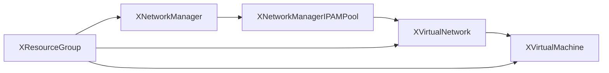

# Platform Overview

Welcome. This platform offers **self-service Azure and Entra ID APIs**. After
the cluster is bootstrapped, teams describe what they need in YAML, commit it,
and Crossplane creates and keeps the resources in sync.

Day-to-day provisioning happens through Git rather than direct portal or
`az` changes.

## What you can create

Compose Azure infrastructure from building blocks such as
[virtual networks](reference/xvirtualnetwork.md),
[automatically allocated IP space](reference/xnetworkmanageripampool.md), and
[Linux or Windows virtual machines](reference/xvirtualmachine.md). Run
containerized workloads with [Container Apps](reference/xcontainerapp.md), or
use managed [PostgreSQL](reference/xdatabase.md) and
[App Service](reference/xappservice.md) APIs. For a more complete starting
point, [XWebApplication](reference/xwebapplication.md) provisions a resource
group, database, App Service, and Key Vault-backed database credential, with
optional custom-domain and Entra ID sign-in support.

The platform also includes Entra ID APIs for
[security groups](reference/xsecuritygroup.md),
[enterprise applications](reference/xenterpriseapp.md), and
[access packages](reference/xaccesspackage.md).

Browse the [full composition reference](reference/index.md) for every
available API, its fields, prerequisites, and examples.

## How it fits together

A typical team starts with a resource group, adds networking, and then places
workloads inside it:

Most Azure compositions reference prerequisites by **logical name**, not by
Azure resource ID, so teams do not need to copy long identifiers between
manifests. The reference pages describe any API-specific references.

## Getting started

1. [Create your team namespace](teams.md) under `teams/`.
2. Choose an API from the list above and follow its reference page, including
   any prerequisites and example manifest.
3. Commit and push. Flux applies it, and Crossplane does the rest.

!!! note "These pages are generated"

    Every reference page is built directly from the
    `CompositeResourceDefinition` manifests in `compositions/`, so the field
    lists, defaults and validation rules always match what is actually
    deployed.

!!! warning "Experimental"

    This documentation site and the compositions it describes are
    demonstration material for a workshop, not a production platform.
